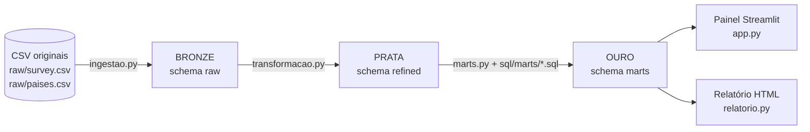

# Saúde mental na tecnologia · 1.259 respostas em números

## O que é este projeto

Um **pipeline de dados** em Python + DuckDB que pega uma pesquisa pública sobre saúde mental em tecnologia (a **Mental Health in Tech Survey 2014**, da OSMI), organiza o dado em três camadas, calcula **dez indicadores em SQL** e os mostra em um painel (Streamlit) e em uma página HTML.

## Por que ele existe

É o **projeto final** do curso de pipeline de dados: partir de uma **fonte própria**, com **duas tabelas ligadas por um `JOIN`**, separar a esteira em **camadas** (a camada original nunca é alterada), calcular cada indicador em **SQL**, **testar** com dados inventados, versionar passo a passo no GitHub e **explicar cada decisão**. O objetivo é transformar perguntas de negócio em respostas que uma pessoa consiga conferir, e dizer com franqueza o que o dado **não** permite concluir.

## De onde vêm os dados

- **`raw/survey.csv`:** a pesquisa **Mental Health in Tech Survey 2014** da [OSMI (Open Sourcing Mental Illness)](https://www.osmihelp.org/research.html): **1.259 respostas** anônimas de pessoas que trabalham com tecnologia, 27 colunas, licença **CC BY-SA 3.0**.
- **`raw/paises.csv`:** tabela de **250 países** (nome, continente, região da ONU) do pacote Python `country_converter` (MIT), usada para ligar cada resposta a um continente.
- Detalhes, crédito, licença e o risco assumido (a cópia veio de um espelho no GitHub) estão em [Fonte e licença](#fonte-e-licença) e em `raw/ORIGEM.md`.

## Que perguntas de negócio ele responde (e onde está a resposta)

Cada indicador é **um arquivo `.sql`**. Esta tabela liga a pergunta de negócio ao SQL que a responde, ao lugar onde ela aparece no painel e a um número-chave:

| # | Pergunta de negócio | SQL (`sql/marts/`) | Onde aparece | Número-chave |
|---|---|---|---|---|
| 01 | De onde vêm as respostas? | `01_respostas_por_continente` | gráfico "Quem respondeu" | América 837 (66,5%) |
| 02 | Quem busca tratamento muda com o gênero? | `02_tratamento_por_genero` | gráfico "Buscaram tratamento por gênero" | Homem 45,4% · Mulher 68,9% |
| 03 | Ter histórico familiar muda a busca por tratamento? | `03_historico_familiar` | aba de dados do relatório (sem gráfico) | com histórico 74,2% · sem 35,5% |
| 04 | A condição interfere no trabalho, e com que frequência? | `04_interferencia_trabalho` | gráfico "A condição interfere no trabalho?" | "Às vezes" 36,9% |
| 05 | O que as pessoas sabem do apoio do empregador? | `05_apoio_empregador` | gráfico "O que o empregador oferece" | benefícios (Sim) 37,9% |
| 06 | Empresa maior oferece mais benefícios? | `06_tamanho_empresa` | gráfico "por tamanho da empresa" | 11,7% (1-5) → 64,9% (mais de 1.000) |
| 07 | Falar de saúde mental assusta mais que falar de saúde física? | `07_consequencias_percebidas` | gráfico "Falar de saúde mental × saúde física" | receio 23,2% × 4,8% |
| 08 | Em que países mais se diz ter benefícios? | `08_ranking_paises` | gráfico "por país" | EUA 53,0% · Reino Unido 10,8% |
| 09 | A busca por tratamento muda com a idade? | `09_faixa_etaria` | gráfico "por faixa de idade" | 44,9% (até 24) → 60,3% (45 ou mais) |
| 10 | Qual é o retrato geral? | `10_kpis` | os seis cartões do topo | 1.259 · 50,6% · 39,1% · 37,9% · 23,2% · 41,0% |

## Arquitetura medalhão: Bronze, Prata e Ouro

As três camadas são **separadas** no banco (um schema por camada), no código (um módulo por camada) e nas specs (um documento por camada):



| Camada | Schema no banco | Quem escreve | Spec | O que contém | Regra que não se quebra |
|---|---|---|---|---|---|
| **Bronze** | `raw` | `pipeline/ingestao.py` | `specs/ingestao.md` | O CSV **como chegou**, tudo em texto: `respostas` (1.259), `paises` (250) | Nenhuma conversão, correção ou descarte |
| **Prata** | `refined` | `pipeline/transformacao.py` + `dicionario.py` | `specs/transformacao.md` | Dado **limpo e tipado**: nomes em português, Sim/Não em `BOOLEAN`, idade conferida, gênero agrupado, valores traduzidos | Lê de `raw`, nunca escreve nela; valor desconhecido **para tudo** |
| **Ouro** | `marts` | `pipeline/marts.py` executa `sql/marts/*.sql` | `specs/marts.md` | **10 indicadores** prontos para a tela (52 linhas) | Toda regra de negócio mora no `.sql`; o painel só lê |

Fluxo resumido: `raw/*.csv ──► raw (bronze) ──► refined (prata) ──► marts (ouro) ──► painel`. O `executar.py` roda as três etapas na ordem.

## Leia isto antes dos números

- **É uma amostra de quem quis responder**, divulgada por canais de tecnologia (59,7% das respostas são dos EUA). Os percentuais descrevem **quem respondeu**, nunca "os profissionais de tecnologia".
- **Não dá para isolar cientistas de dados.** A pesquisa não tem coluna de profissão. O projeto fala de "pessoas de tecnologia".
- **Mostra associação, não causa**, e não é diagnóstico.
- É um dado sensível, mesmo anonimizado: ninguém aqui é identificado e o pipeline **não propaga o campo de comentários livres** (`comments`) para além da camada `raw`.

## O que ele usa (stack)

- Python 3.13, gerenciado com `uv`
- DuckDB 2
- pandas 3
- Streamlit + Plotly (painel) e um relatório HTML de arquivo único (HTML, CSS e JS sem biblioteca extra, além do Plotly)
- ruff e pytest com cobertura (dev)

## Como rodar

Precisa do [uv](https://docs.astral.sh/uv/) (ele baixa o Python e as dependências sozinho). No Windows, instale com
`powershell -ExecutionPolicy ByPass -c "irm https://astral.sh/uv/install.ps1 | iex"` e **abra um terminal novo** depois.

```bash
git clone https://github.com/ivanostorari/projeto_final_junior.git
cd projeto_final_junior

uv sync                                   # instala as dependências (cria .venv)

uv run python -m pipeline.ingestao        # 1. raw/*.csv -> schema raw
uv run python -m pipeline.transformacao   # 2. raw -> schema refined
uv run python -m pipeline.marts           # 3. refined -> schema marts

uv run streamlit run app.py               # painel em http://localhost:8501
```

Atalho: `uv run python executar.py` apaga o banco e roda as três etapas, na ordem.

Outros comandos, todos opcionais:

```bash
uv run python ver_marts.py                # os 10 indicadores no terminal (só lê)
uv run python ver_marts.py kpis ranking_paises   # só os marts que você pedir
uv run python conferir.py                 # confere os números da tela contra os marts (31 conferências)
uv run python relatorio.py                # gera relatorio.html: página completa em um arquivo (abre com dois cliques)
```

O `.duckdb` aceita um único processo escrevendo. Com o banco aberto em outro programa (DBeaver, extensão DuckDB do VS Code, um notebook), as etapas do pipeline falham com "Could not set lock on file". Feche o outro programa antes de rodar o pipeline. O painel abre o banco em modo somente leitura e fecha a conexão logo após ler, então não atrapalha.

Todas as etapas são idempotentes: rodar duas vezes produz exatamente a mesma saída.

Saída esperada de `executar.py`: `raw.respostas 1.259` e `raw.paises 250` (total 1.509); o resumo `raw → refined` (1.259 → 1.259, 8 idades zeradas, contagem por gênero); e `✓ marts.<nome> N linhas` para os dez marts (52 linhas).

## Estrutura

```
projeto_final_junior/
├── raw/                    survey.csv (OSMI, intocado), paises.csv e ORIGEM.md (crédito e licença)
├── preparar_paises.py      gera raw/paises.csv (e registra por que ISO2 ficou de fora)
├── pipeline/
│   ├── db.py               conexão com o saude_mental.duckdb, compartilhada pelas etapas
│   ├── saida.py            formatação da saída no terminal (milhar com ponto)
│   ├── ingestao.py         etapa 1: CSV -> raw
│   ├── dicionario.py       traduções, valores permitidos, mapa de gênero, limites de idade
│   ├── transformacao.py    etapa 2: raw -> refined
│   └── marts.py            etapa 3: refined -> marts (executa sql/marts/*.sql)
├── sql/marts/              um .sql por indicador (NN_<nome>.sql)
├── specs/
│   ├── ingestao.md         spec da etapa 1
│   ├── transformacao.md    spec da etapa 2
│   ├── marts.md            spec da etapa 3 e definições dos indicadores
│   ├── painel.md           spec do painel
│   └── testes.md           regra dos testes e dados inventados
├── painel.py               leitura dos marts, formatação e gráficos (sem Streamlit)
├── app.py                  página Streamlit
├── relatorio.py            o mesmo painel como um HTML único
├── executar.py             roda as três etapas do zero
├── ver_marts.py            mostra os marts no terminal
├── conferir.py             confere os números da tela contra os marts
├── test/                   testes (pytest), um arquivo por módulo
└── pyproject.toml          dependências e configuração do ruff, do pytest e da cobertura
```

O arquivo `saude_mental.duckdb` é gerado pelo pipeline na raiz do projeto e não é versionado (nem o `relatorio.html`). Todos os caminhos são resolvidos a partir da localização dos arquivos `.py`.

## Fonte e licença

| Arquivo (`raw/`) | O que é | Fonte | Licença |
|------------------|---------|-------|---------|
| `survey.csv` | 1.259 respostas, 27 colunas, de 27/08/2014 a 01/02/2016 | [OSMI, Mental Health in Tech Survey](https://www.osmihelp.org/research.html) (link "Get raw data" da pesquisa de 2014) | **CC BY-SA 3.0** (Unported) para a pesquisa de 2014, segundo a [página de pesquisa da OSMI](https://www.osmihelp.org/research.html) (as de 2016 a 2021 são 4.0) |
| `paises.csv` | 250 países com continente e região da ONU | pacote Python [`country_converter`](https://github.com/IndEcol/country_converter) 1.3.2, gerado por `preparar_paises.py` | MIT |

**Risco assumido:** a cópia de `survey.csv` usada aqui veio de um espelho no GitHub (`alvin-98/mental-health-survey-2014`), porque o site da OSMI e outros repositórios de dados estavam inacessíveis para download no ambiente em que o projeto foi construído. O espelho não declara licença nem origem. O arquivo está **como foi baixado** (SHA-256 `3c4e3e16917f74b5e219ba01caecd09f9dc464c4848becdd018c9442d627abb4`), e o texto das 27 perguntas foi conferido contra a [tabela de perguntas do UZH DataTalk](https://datatalkturk.ifi.uzh.ch/datatalkturk/html/dataset_info_elements/mental_health/question_overview_table.html). **Antes de publicar:** baixe o arquivo original no site da OSMI ("Get raw data"), compare o SHA-256 e confira o texto da licença. A CC BY-SA exige dar o crédito à OSMI e manter a mesma licença em adaptações do **dado**.

## O grão de cada tabela

**Grão** é o que **uma linha** da tabela representa. Dizer o grão antes de escrever uma consulta evita contar duas vezes e ligar tabelas pela coluna errada. Cada `.sql` traz o grão na primeira linha, como comentário.

### Bronze (`raw`) e Prata (`refined`): as duas tabelas de entrada

| Tabela (nas duas camadas) | Uma linha é… | Linhas | Chave |
|---|---|---|---|
| `respostas` | **uma pessoa que respondeu** ao questionário (anônimo) | 1.259 | `id_resposta` (só na prata) = ordem no arquivo; não identifica ninguém. Não há chave natural: o `timestamp` não é único (1.246 valores distintos em 1.259 linhas) |
| `paises` | **um país** | 250 | `nome` |

Na bronze tudo é texto e a ordem do arquivo fica no `rowid` do banco; a prata cria `id_resposta` a partir dele.
Ligação: `respostas.pais = paises.nome`.

### Ouro (`marts`): um indicador por tabela

| Mart | Uma linha é… | Linhas |
|---|---|---|
| `respostas_por_continente` | um continente (o do país informado) | 5 |
| `tratamento_por_genero` | um grupo de gênero | 4 |
| `historico_familiar` | uma resposta a "tem histórico familiar?" (Sim ou Não) | 2 |
| `interferencia_trabalho` | uma resposta a "a condição interfere no trabalho?" | 5 |
| `apoio_empregador` | uma pergunta de apoio × uma resposta | 15 |
| `tamanho_empresa` | uma faixa de número de funcionários | 6 |
| `consequencias_percebidas` | um tipo de saúde (mental ou física) | 2 |
| `ranking_paises` | um país com 20 respostas ou mais | 7 |
| `faixa_etaria` | uma faixa de idade | 5 |
| `kpis` | a pesquisa inteira | 1 |

Total: **52 linhas** em 10 tabelas.

> **A armadilha do projeto:** ligar `respostas` com `paises` pelo **continente**, e não pelo nome, não dá erro nenhum e devolve **67.313 linhas** (53 vezes as 1.259 respostas). O `ON` é sempre o nome do país, e há teste que confere que o `JOIN` não muda a contagem.

### O que cada pergunta da pesquisa pergunta (as colunas que importam)

| Coluna em `refined.respostas` | Pergunta (original, conferida) | Respostas |
|---|---|---|
| `tratamento` | Have you sought treatment for a mental health condition? | Sim/Não |
| `historico_familiar` | Do you have a family history of mental illness? | Sim/Não |
| `interferencia_trabalho` | If you have a mental health condition, do you feel that it interferes with your work? | Nunca … Frequentemente (nulo = sem resposta) |
| `beneficios` | Does your employer provide mental health benefits? | Sim / Não / Não sei |
| `opcoes_cuidado` | Do you **know the options** for mental health care your employer provides? | Sim / Não / Não tenho certeza |
| `consequencia_saude_mental` | Do you think that discussing a mental health issue with your employer would have **negative consequences**? | Sim / Talvez / Não |
| `falaria_entrevista_mental` | Would you **bring up** a mental health issue with a potential employer in an interview? | Sim / Talvez / Não |
| `falaria_supervisor` | Would you be **willing to discuss** a mental health issue with your direct supervisor(s)? | Sim / Alguns / Não |

Atenção: "Sim" **não significa a mesma coisa** em perguntas diferentes (receio × disposição).

## Etapas

### 1. Ingestão · raw

`pipeline/ingestao.py` copia os 2 CSVs para o schema `raw`, com tabelas em português e colunas com os nomes originais. Spec em `specs/ingestao.md`.

| arquivo | tabela | linhas | colunas |
|---------|--------|--------|---------|
| `survey.csv` | `raw.respostas` | 1.259 | 27 |
| `paises.csv` | `raw.paises` | 250 | 5 |

**Regra central:** `raw` é o espelho do que chegou. Nenhuma conversão de tipo, linha descartada, coluna renomeada ou valor corrigido. Tudo entra como `VARCHAR`. A única mudança é o marcador de nulo, que é **por arquivo**: na pesquisa, `NA` vira nulo; no arquivo de países, só a string vazia (a coluna `ISO2` do pacote traz `NA` para a Namíbia e uma expressão regular para o Reino Unido, e por isso ficou de fora). Se faltar qualquer CSV, o script lista quais, diz a pasta e para antes de gravar qualquer coisa. Por que tudo como texto: `Age` tem `99999999999` e `-1726`; se a leitura inferisse número, passariam sem ninguém ver.

### 2. Transformação · refined

`pipeline/transformacao.py` (com `pipeline/dicionario.py`) — spec em `specs/transformacao.md`.

- **Nomes:** colunas em `snake_case` português (`historico_familiar`, `interferencia_trabalho`, `falaria_supervisor`...); `id_resposta` é a chave.
- **Tipos:** `Timestamp` vira `TIMESTAMP`; Sim/Não viram `BOOLEAN`; idade vira `INTEGER`; perguntas com mais de duas respostas ficam `VARCHAR` com valores em português, traduzidos pelo dicionário.
- **Dicionário:** é tradução e também lista de valores permitidos. **Valor fora do dicionário para tudo**, nunca vira nulo em silêncio. Nada de `TRY_*` para esconder erro de conversão.
- **Nulos:** os nulos da `raw` continuam nulos; nenhum é preenchido (estado 515, autônomo 18, interferência no trabalho 264).
- **Idade impossível** (8 respostas: `-1726`, `-29`, `-1`, `5`, `8`, `11`, `329`, `99999999999`): `idade` vira nulo e o original fica em `idade_informada`. Limite 16–80, numa constante.
- **Gênero** (texto livre, 49 grafias) agrupado em 4 categorias por um mapa escrito em `pipeline/dicionario.py`: Homem 990, Mulher 251, Outras identidades 14, Não informado 4. Só entra em Homem/Mulher a resposta inequívoca. **É uma decisão sobre pessoas e é discutível**: leia o critério na spec e discorde dele se for o caso. Grafia fora do mapa **para tudo**.
- **País:** dois nomes da pesquisa diferem da tabela de países (`Bahamas, The` → Bahamas; `Czech Republic` → Czechia), por um alias escrito no dicionário.
- **`comments` sai** da `refined` (texto livre sobre saúde mental, risco de identificar pessoas).
- **Duplicatas:** não há chave natural. `id_resposta` é a ordem no arquivo; o resumo informa quantas linhas são idênticas a outra (hoje, 0).
- **Falhas:** valor fora do formato declarado, ou fora do dicionário, para a execução com exemplos, sem gravar nenhuma tabela. Tudo roda numa transação: se algo falhar, `refined` continua como estava.

Saída esperada: 2 tabelas, **1.509 linhas** no total (`respostas` 1.259 → 1.259; `paises` 250 → 250). A contagem antes e depois prova que nenhuma resposta se perdeu.

### 3. Marts · marts

`pipeline/marts.py` — spec em `specs/marts.md`.

Cada arquivo `sql/marts/NN_<nome>.sql` vira a tabela `marts.<nome>` (`CREATE TABLE marts.<nome> AS <conteúdo do arquivo>`). Toda regra de negócio mora no `.sql`; o Python não monta nem altera SQL. O schema `marts` é apagado e recriado a cada execução, dentro de uma transação: qualquer falha (SQL com erro, mart vazio, nome inválido ou duplicado) faz `ROLLBACK`.

| arquivo | grão | pergunta | linhas |
|---------|------|----------|--------|
| `01_respostas_por_continente` | continente | De onde vêm as respostas? | 5 |
| `02_tratamento_por_genero` | grupo de gênero | Quem busca tratamento muda com o gênero? | 4 |
| `03_historico_familiar` | Sim ou Não | Histórico familiar muda a busca por tratamento? | 2 |
| `04_interferencia_trabalho` | resposta | A condição interfere no trabalho, e com que frequência? | 5 |
| `05_apoio_empregador` | pergunta × resposta | O que as pessoas sabem do apoio do empregador? | 15 |
| `06_tamanho_empresa` | faixa de tamanho | Empresa maior oferece mais benefícios e licença? | 6 |
| `07_consequencias_percebidas` | tipo de saúde (mental ou física) | Falar de saúde mental assusta mais que falar de saúde física? | 2 |
| `08_ranking_paises` | país com 20+ respostas | Em que países mais se diz ter benefícios? | 7 |
| `09_faixa_etaria` | faixa etária | A busca por tratamento muda com a idade? | 5 |
| `10_kpis` | a pesquisa inteira | O retrato geral (os seis cartões do painel) | 1 |

Total: 52 linhas.

#### Definições usadas nos indicadores

| Palavra | Quer dizer |
|---------|------------|
| Respondente | uma linha de `respostas` |
| Buscou tratamento | respondeu **Sim** a "Have you sought treatment for a mental health condition?" |
| Tem benefícios | respondeu **Sim** a "Does your employer provide mental health benefits?" (`Não sei` fica no denominador) |
| Percentual | 0 a 100, uma casa; denominador = o grupo da linha (ou todas as respostas, quando a coluna diz `pct_das_respostas`) |
| Amostra pequena | grupo com menos de 20 respostas: fica fora de gráfico de taxa, a nota diz quem, e o dado continua no mart |

Cada `.sql` começa com um comentário com o **grão** (o que é uma linha dele). Rankings só com 20+ respostas.

#### Resultados medidos

Rodando o pipeline, e conferidos por um segundo caminho (pandas direto no CSV): 1.259 respondentes · 50,6% buscaram tratamento · 39,1% com histórico familiar · 37,9% dizem que o empregador oferece benefícios · 23,2% receiam consequência negativa ao falar de saúde mental com o empregador (× 4,8% para saúde física) · 41,0% falariam com o supervisor. Entre quem tem histórico familiar, 74,2% buscaram tratamento (35,5% entre quem não tem). Quem diz ter benefícios: de 11,7% (1–5 funcionários) a 64,9% (mais de 1.000). **São números da amostra**; leia "Leia isto antes dos números".

**Conferência cruzada:** `sum(respondentes)` dos marts 01, 02, 03, 04, 06 e 09 dá 1.259 nos seis, e cada pergunta do mart 05 também soma 1.259.

#### Números da tela

É o que o painel, o `relatorio.html` e o `ver_marts.py` têm que mostrar. `conferir.py` confere todos.

| Na tela | Mart · coluna | Valor |
|---------|---------------|-------|
| Respondentes | `kpis.respondentes` | 1.259 |
| Buscaram tratamento | `kpis.pct_tratamento` | 50,6% |
| Histórico familiar | `kpis.pct_historico_familiar` | 39,1% |
| Dizem ter benefícios | `kpis.pct_beneficios_sim` | 37,9% |
| Receiam consequência (saúde mental) | `kpis.pct_receio_consequencia` | 23,2% |
| Falariam com o supervisor | `kpis.pct_falaria_supervisor` | 41,0% |
| Tratamento, Homem · Mulher | `tratamento_por_genero.pct_tratamento` | 45,4% · 68,9% |
| Tratamento, com · sem histórico familiar | `historico_familiar.pct_tratamento` | 74,2% · 35,5% |
| Benefícios, empresa de 1–5 · de mais de 1.000 | `tamanho_empresa.pct_beneficios_sim` | 11,7% · 64,9% |
| Benefícios, EUA · Reino Unido (7º de 7) | `ranking_paises.pct_beneficios_sim` | 53,0% · 10,8% |
| Receio, saúde física | `consequencias_percebidas.pct_receio_sim` | 4,8% |
| Disposição na entrevista, saúde mental | `consequencias_percebidas.pct_entrevista_sim` | 3,5% |
| Respostas da América | `respostas_por_continente.respondentes` | 837 |
| Idades impossíveis | `faixa_etaria` (`sem_idade_valida`) | 8 |

#### As diferenças que têm nome

Cada linha tem o número que a tela mostra, um número **errado** que um erro comum produz, e o motivo. `conferir.py` reproduz os dois lados.

| Certo | Errado | Por quê |
|-------|--------|---------|
| 50,6% | 73,2% | Média dos 4 percentuais por gênero: média de médias (cada grupo pesa igual, de 4 a 990 pessoas) |
| 50,6% | 48,6% | Média dos 5 percentuais por continente: mesma média de médias |
| 50,6% | 292,9% | Soma dos percentuais por gênero: a agregação padrão de uma ferramenta de BI sobre uma coluna de percentual |
| 37,9% | 56,1% | Benefícios sem contar o "Não sei" no denominador (477 de 851 em vez de 477 de 1.259) |
| 1.259 | 6.295 | Soma de `respondentes` do mart 05 sem filtrar a pergunta: cada pessoa aparece em 5 perguntas (5 × 1.259) |
| 1.259 | 67.313 | `JOIN` de respostas com países pelo continente em vez do nome: 53 vezes mais linhas, sem erro |

## Painel

`app.py` é a página Streamlit; `painel.py` concentra leitura, formatação e gráficos e não importa Streamlit (por isso o `relatorio.py` reaproveita o mesmo código para gerar um HTML). Spec em `specs/painel.md`.

- Lê os 10 marts com `SELECT * FROM marts.<nome>` e **não faz nenhum cálculo**: só ordena, filtra linhas, pega as primeiras n e formata. Número novo na tela exige um `.sql` novo em `sql/marts/`.
- **Layout:** seis cartões de KPI; "Quem respondeu, e quem buscou tratamento" (continente, gênero, faixa etária); "O que o empregador oferece" (apoio, tamanho da empresa, ranking de países); "Falar abertamente sobre o assunto" (interferência no trabalho, receio × disposição). Oito gráficos.
- **Amostra primeiro:** grupo com menos de 20 respostas não vira gráfico de taxa, o *n* aparece em cada gráfico, e o painel não escreve conclusões ("isso mostra que...").
- Aviso de que é uma amostra e não um diagnóstico, com o CVV (188) para quem se reconhecer no assunto.
- Números no padrão brasileiro (milhar com ponto, decimal com vírgula), independente do locale da máquina.
- **Relatório HTML** (`relatorio.py` → `relatorio.html`): o mesmo painel numa página única, com menu, tema claro e escuro e layout que se adapta ao celular. **Clicar numa barra abre o detalhe** daquele item, com os botões **Voltar** (volta ao mesmo ponto da página) e **Início**. A seção **Dados completos** tem uma aba com a tabela inteira de cada um dos 10 marts. Nada é calculado na página: o detalhe e as tabelas copiam o que os marts já têm. Precisa de internet só para os gráficos (Plotly via CDN).
- Botão **Recarregar dados** limpa o cache depois de rodar o pipeline de novo. Se o banco ou algum mart faltar, a página mostra o que falta e o comando para gerar.

## Testes e qualidade

```bash
uv run pytest --cov                # todos os testes, com cobertura (mínimo exigido: 60%)
uv run ruff check .                # lint
```

Os testes ficam em `test/`, um arquivo por módulo. **Nenhum teste abre `saude_mental.duckdb` nem lê `raw/`**: cada um constrói um banco temporário com **dados inventados** (oito respostas e seis países, em `test/conftest.py`, cada linha com o motivo de existir escrito). Nenhum texto de resposta real aparece nos testes. Os valores esperados dos marts foram calculados **à mão** sobre essas linhas. Cobrem as regras das specs: conversões e formatos rejeitados, nulos, "nada é gravado" quando algo falha, `ROLLBACK`, idempotência, o `JOIN` que não muda a contagem, o corte de 20 respostas (EUA, Reino Unido e Canadá com 20; Alemanha com 19 fica de fora por **uma** resposta), a formatação brasileira dos números, o painel, o relatório, o `ver_marts.py` e o `conferir.py`.

Resultado: **149 testes**, cobertura total de 98% (o `fail_under` do `pyproject.toml` é 60%), `ruff` sem erros. Regra e dados inventados em `specs/testes.md`.

## Explorando com SQL

Além do `ver_marts.py`, o banco pode ser consultado direto (feche antes o painel e qualquer outro programa que o tenha aberto para escrita):

```sql
FROM marts.kpis;
FROM marts.ranking_paises ORDER BY pct_beneficios_sim DESC;
FROM marts.tratamento_por_genero;
```

## Requisitos do desafio e onde cada um está

| Requisito | Onde está |
|-----------|-----------|
| Fonte escolhida por você, com link e licença | seção "Fonte e licença" e `raw/ORIGEM.md` |
| Duas tabelas ou mais, ligadas por uma chave (JOIN) | `respostas` × `paises` pelo nome do país; JOIN em `sql/marts/01_*.sql` e `08_*.sql` |
| Três camadas, e na bruta nada é alterado | `raw` → `refined` → `marts` (seção "Etapas"); `pipeline/ingestao.py` proíbe converter, descartar ou corrigir |
| Testes unitários com dado inventado, sem abrir o banco do projeto | `test/` (149 testes, `uv run pytest --cov`); `specs/testes.md` |
| Repositório público no GitHub pessoal | <https://github.com/ivanostorari/projeto_final_junior> |
| Histórico: um commit por etapa, com mensagem | `git log --oneline` (spec e código de cada etapa em commits separados; o primeiro commit é a exceção, veja a última seção) |
| Dashboard opcional, lendo só dos marts, sem cálculo na tela | `painel.py` + `app.py` + `relatorio.py`; `specs/painel.md` |
| Cada indicador tem um `.sql` de onde saiu; cada decisão tem um motivo escrito | `sql/marts/*.sql` (10 arquivos) e `specs/*.md` |
| A IA em todas as etapas, e o que ela errou | última seção deste README |

## Como este repositório é versionado

- **`main` é a versão estável.** Mudança nova entra por uma **branch separada** (`feat/...`, `docs/...`, `fix/...`) e volta para a `main` por **pull request**, mesmo trabalhando sozinho: o pull request deixa registrado o que mudou e por quê, e dá o momento de reler antes de juntar.
- **Um commit por etapa**, com mensagem que diz o que mudou (`feat:`, `docs:`, `test:`, `chore:`).
- **Honestidade sobre o histórico:** os 15 primeiros commits (as etapas 1 a 14 e a primeira versão do relatório HTML) foram feitos direto na `main`. A prática de branch + pull request vale a partir daqui.
- Nunca se reescreve histórico já publicado (`git push --force`).

## Quando quebrar

Todos os erros abaixo foram reproduzidos neste projeto.

| O que aparece | Causa | Como resolver |
|---------------|-------|---------------|
| `ModuleNotFoundError: No module named 'duckdb'` (ou `'pipeline'`, `'streamlit'`) | Rodou o arquivo pelo botão do Code Runner / `python arquivo.py`: usa o Python global, sem as bibliotecas, e fora da raiz | Sempre pelo terminal, na raiz: `uv sync` e `uv run python executar.py` (ou `uv run python -m pipeline.marts`) |
| `IO Error: Could not set lock on file ... Conflicting lock is held in ...` | Outro programa tem o banco aberto para escrita: DBeaver, extensão DuckDB do VS Code, um notebook com `duckdb.connect('saude_mental.duckdb')` ou outro terminal rodando o pipeline | Feche o programa (no notebook, `con.close()`) e rode de novo. **O painel não causa isso**: ele abre o banco só para leitura e fecha |
| O painel mostra o número antigo depois de rodar o pipeline | `st.cache_data` guarda a leitura | Botão **Recarregar dados** na página (ou pare e suba o painel de novo) |
| `Required test coverage of 60% not reached` (com `Total coverage: 0.00%`) | Rodou `pytest --cov` em um arquivo só, por exemplo `test/test_db.py` | `uv run pytest --cov`, sem apontar arquivo. Não baixe o `fail_under` |
| `no tests ran` / `collected 0 items` | Rodou fora da raiz, ou apontou uma pasta sem testes (`pytest pipeline`) | Na raiz, `uv run pytest`. Os testes ficam em `test/`, em arquivos `test_*.py` |
| `Port 8501 is already in use` | Já há um painel de pé | Feche o outro, ou `uv run streamlit run app.py --server.port 8502` |
| As barras saem em ordem alfabética (Às vezes, Frequentemente, Nunca, Raramente) | A ferramenta ordena texto; a ordem certa está na coluna `ordem` do mart | Ordene pela coluna `ordem`, nunca pelo texto |
| Um mart exportado e aberto no Excel em português mostra `379` em vez de `37,9`, ou `6-25` vira data | Ponto decimal e faixa lidos como número/data | Importe o CSV como texto (Dados > De Texto/CSV). Nunca abra e salve de volta `raw/survey.csv` no Excel |
| `use_container_width is deprecated` | Código antigo de Streamlit | Aqui já é `width="stretch"`; se aparecer, o arquivo foi sobrescrito por uma versão antiga |
| `'uv' não é reconhecido como um comando interno ou externo` | O `uv` não está instalado, ou o terminal foi aberto antes da instalação | Instale o `uv` (comando em "Como rodar") e **abra um terminal novo** |
| `error: The current directory (...) is not a valid package name` | O `uv init` rodou fora da pasta do projeto (por exemplo, na pasta do usuário do Windows, que tem acento e maiúsculas) | Crie a pasta do projeto em um caminho sem acento nem espaço (ex.: `C:\projeto`) e rode o `uv init` dentro dela |
| `Author identity unknown`, depois `src refspec main does not match any` | O Git não sabe o nome e o e-mail do autor, então o commit não é criado e a branch `main` não existe | `git config user.name` e `git config user.email` (sem `--global` em computador compartilhado), refaça o commit e o `git push` |
| `! [rejected] main -> main (fetch first)` | O repositório do GitHub foi criado com README ou licença, e tem um commit que a pasta local não tem | Crie o repositório **vazio**, sem README, `.gitignore` nem licença |
| "Quebrei tudo e não sei onde" | — | `uv run python executar.py` (apaga o banco e refaz as três etapas; cada uma para com mensagem clara), depois `uv run python conferir.py` (mostra qual número divergiu). No git: `git status`, `git diff`, `git restore <arquivo>` |

## Limites conhecidos

- Amostra autosselecionada, de 2014 a 2016, 59,7% dos EUA, sem profissão: não generaliza e não isola cientistas de dados.
- "Outras identidades" (14) e "Não informado" (4) são pequenos demais para percentual; só aparecem em contagem.
- `interferencia_trabalho` é nula para 264 pessoas (260 delas não buscaram tratamento); isso sugere "não se aplica", mas é hipótese, e o indicador as chama de `sem_resposta`.
- Quatro respostas têm estado dos EUA e país estrangeiro (ex.: Letônia/NY). Ficam como vieram; nenhum indicador usa `estado`.
- As faixas de tamanho da empresa vêm da pesquisa como são (`26-100` e `100-500` dividem o valor 100).

## Licença e créditos

Dados: pesquisa da OSMI de 2014 (CC BY-SA 3.0; crédito: Open Sourcing Mental Illness, osmihelp.org) e tabela de países do `country_converter` (MIT). Código: licença MIT, em [`LICENSE`](LICENSE). A licença do código não muda a dos dados: a pesquisa continua sob CC BY-SA 3.0 e quem reutiliza o dado mantém o crédito à OSMI.

## Onde a IA errou ou assumiu (e como foi descoberto)

### Quem fez o quê

O tema (saúde mental na tecnologia) foi pedido pelo autor. **A escolha da base (OSMI 2014), as specs, o código e os testes foram escritos por uma IA (Claude).** O autor montou o ambiente, recebeu os arquivos etapa por etapa, executou cada comando na própria máquina, comparou a saída com o resultado esperado e fez cada commit (de 2 a 14). O primeiro commit (`Configura o projeto com dependências e lockfile`) foi gerado numa sessão anterior de IA, com coautoria registrada, e não passo a passo pelo autor.

### O que a IA errou ou assumiu sem conferir


1. **Fonte.** A IA tentou seis fontes de dados (OpenML, Figshare, Mendeley, Hugging Face, Zenodo e o site da OSMI): todas bloqueadas no ambiente. Sobrou um espelho no GitHub, sem licença nem origem declaradas. Por isso o README diz que o arquivo **precisa ser conferido contra o original** antes de publicar.
2. **Chave de país.** Assumiu que o código ISO2 serviria para ligar as tabelas. *Descoberto inspecionando o arquivo do pacote:* o Reino Unido vem como `^GB$|^UK$` (uma expressão regular) e a Namíbia como `NA`, igual ao marcador de nulo da pesquisa. ISO2 saiu; a ligação é pelo nome.
3. **"Sim" com dois sentidos (mart 07).** A IA juntou numa coluna `pct_sim` duas perguntas em que "Sim" quer dizer o oposto: *receio* de consequência e *disposição* de falar numa entrevista. *Descoberto relendo os números* (saúde mental 23,2% × 3,5%) e conferindo o texto das perguntas. Corrigido: colunas separadas, e as colunas `conversa_*` viraram `falaria_*`.
4. **Licença de memória.** A IA escreveu "CC BY-SA 4.0" para a pesquisa de 2014 sem ter verificado. *Conferido* na página da OSMI: a de 2014 é **CC BY-SA 3.0** (as de 2016 em diante é que são 4.0). Corrigido aqui e na spec.
5. **Rótulo que enganava.** `opcoes_cuidado = Sim` parece "o empregador oferece"; a pergunta é "você **conhece** as opções". Texto conferido e anotado.
6. **Palpite numérico na spec.** Escreveu que o `JOIN` errado por continente devolve "centenas de vezes" mais linhas. *Medido:* 67.313 linhas (53 vezes); por região da ONU, 9.819. A frase foi trocada pelo número.
7. **Teste mal escrito.** Um teste do mart 07 desempacotava três valores de uma linha de dois, e o primeiro rascunho de um teste do relatório não verificava nada do projeto (foi removido). *Descoberto:* o teste falhou na primeira execução, e a revisão dos testes verdes achou o outro.
8. **Rótulo cortado no painel.** A primeira versão do gráfico por continente cortava o texto "837 (66,5%)" e girava os rótulos de tamanho de empresa. *Descoberto:* abrindo o `relatorio.html` num navegador (Chromium sem tela) e olhando a imagem; as margens e as quebras de linha foram ajustadas.
9. **Conta de cabeça.** Ao escrever a tabela de erros comuns, a IA estimou o percentual de benefícios sem o "Não sei" em 56,0%. *Medido rodando a conta:* 56,1% (477 de 851). O número virou uma das conferências de `conferir.py`. Os erros de "Quando quebrar" foram todos reproduzidos antes de entrar aqui (a mensagem real de cobertura, por exemplo, mostra `Total coverage: 0.00%`).
10. **Versão do Python no `uv init --bare`.** O roteiro da aula usa `uv init --bare` e depois `uv venv --python 3.13`. A IA testou e viu que o `uv init --bare` grava em `requires-python` a versão do Python **da máquina**; se ela não for a 3.13, o `uv venv` só avisa, e o `uv add` seguinte **recria o `.venv` com outra versão, sem perguntar**. *Descoberto* reproduzindo o caso com `requires-python = ">=3.14"`. Forma segura: `uv init --bare --python 3.13`.
11. **Pacote de etapas com numeração velha.** O guia que acompanha as etapas ficou com a numeração antiga depois que o roteiro mudou (ambiente e versionamento passaram a ser as etapas 1 e 2). *Descoberto* ao reler o guia contra o pacote; o guia foi reescrito.

O que a IA **não** conferiu: o painel em celular ou em outro navegador; a licença da pesquisa na fonte original; se o agrupamento de gênero agrada a quem vai usar o painel.

### O que o autor conferiu

- Rodou `uv run pytest --cov` e `uv run ruff check .` na própria máquina (Windows, PowerShell): **149 testes passando**, cobertura de **98%** e `ruff` sem erros.
- Executou cada etapa na própria máquina e comparou a saída com o resultado esperado antes de cada commit (de 2 a 14).

### O que a IA conferiu

- Em um clone novo do repositório público, numa pasta fora do projeto: `uv sync`, `executar.py` (10 marts, 52 linhas), `ver_marts.py kpis`, `conferir.py` (**31 de 31 conferidos**), `pytest --cov` (133 passando, 98%) e `ruff`.

**Ainda pendente:** comparar o SHA-256 do `survey.csv` com o do arquivo original da OSMI (site oficial) e conferir o texto da licença na fonte.
